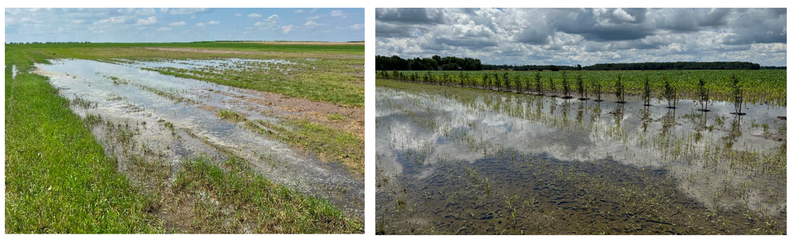
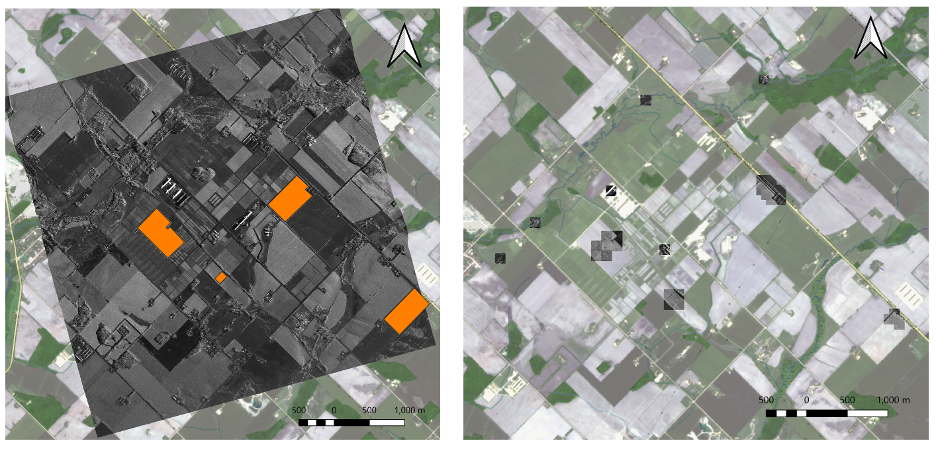
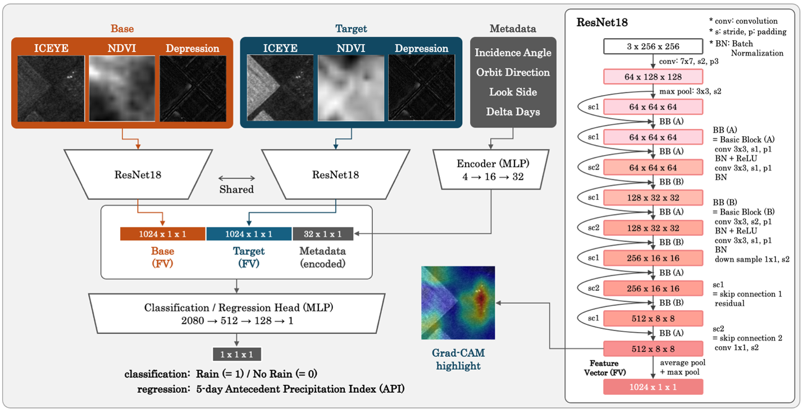
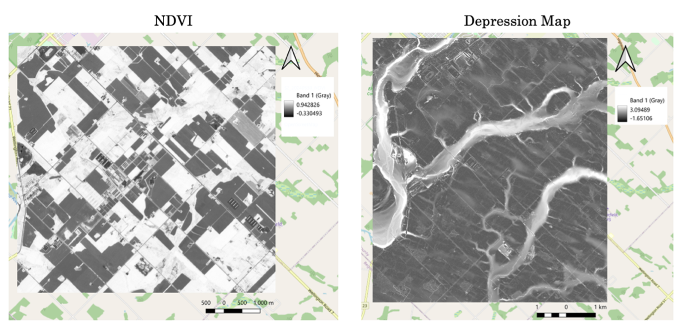
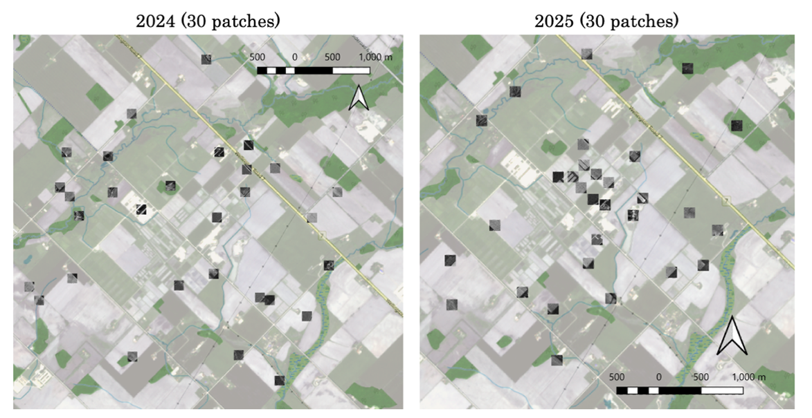
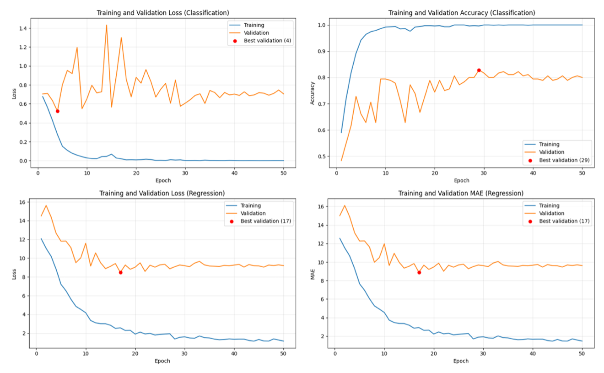
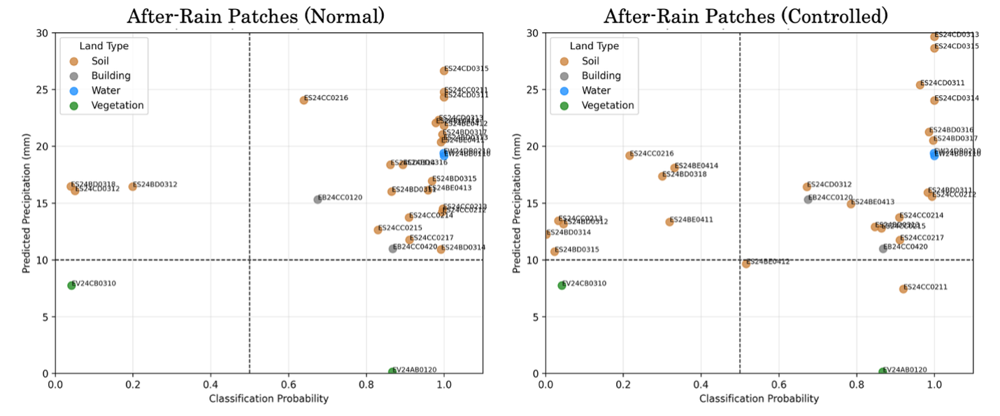
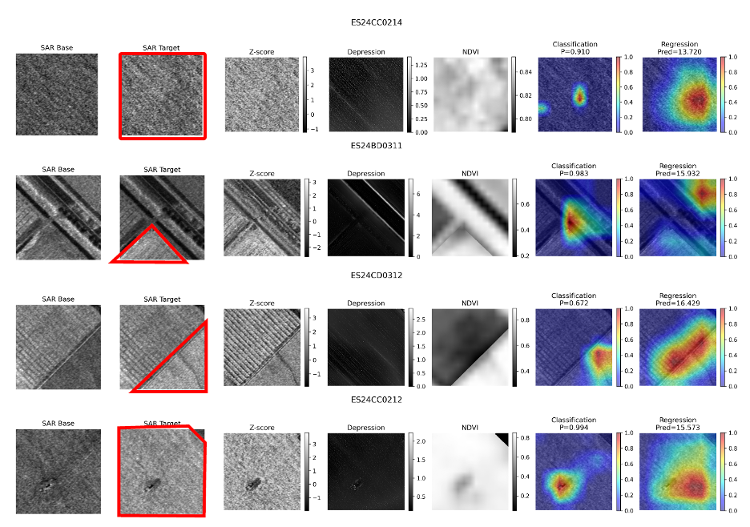
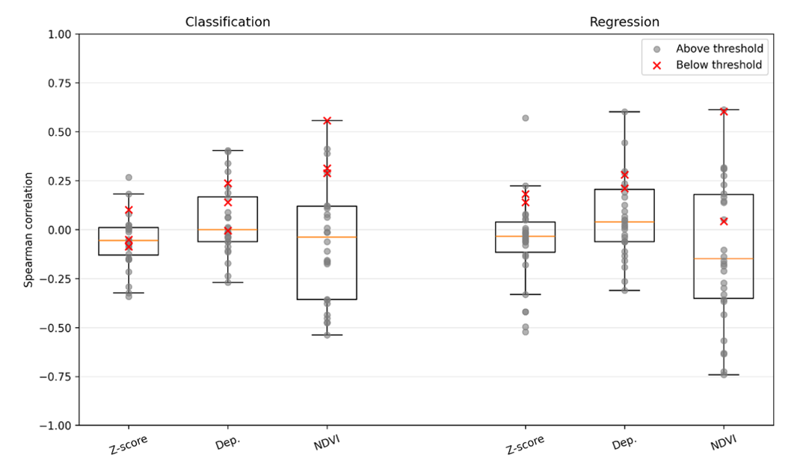

# Flood Detection in Agricultural Fields Using High-Resolution SAR Imagery and Deep Learning

## Abstract
This project investigates the use of high-resolution ICEYE SAR imagery for flood detection. Waterlogging in agricultural fields can negatively affect soil conditions and agricultural operations, but detecting small-scale waterlogging using satellite imagery remains challenging. In particular, the limited availability of field-verified flooding evidence makes it difficult to train and evaluate conventional image segmentation models. This study proposes a deep learning approach that combines a Siamese Network and Grad-CAM to detect potential waterlogged areas from high-resolution ICEYE Synthetic Aperture Radar (SAR) imagery without requiring pixel-level segmentation labels.

The proposed model takes a pair of SAR images acquired at different times and predicts precipitation conditions between the acquisitions. ResNet-18 is used as the shared backbone of the Siamese Network to extract spatial features from the two images. Terrain information, vegetation information, and SAR acquisition metadata are also incorporated as additional inputs. Grad-CAM is applied to the final convolutional layer of ResNet-18 to identify spatial regions contributing to the precipitation prediction. The hypothesis is that spatial features associated with waterlogging may contribute to precipitation prediction and consequently be highlighted by Grad-CAM.

A dataset consisting of 960 image pairs was constructed from ICEYE imagery acquired over the Elora Research Station in Ontario, Canada, during 2024 and 2025. The dataset was divided into 720 training, 180 validation, and 60 test pairs. Due to the limited field evidence, synthetic test patches were created to enable quantitative evaluation of the spatial overlap between Grad-CAM highlights and field-verified flooded areas.

The results show that both classification and regression models can predict precipitation events with reasonable performance, while Grad-CAM produces spatial highlights in most test patches. However, the highlights do not consistently correspond to waterlogged areas and can also react to other land cover types and unchanged dry areas. Therefore, although the proposed approach demonstrates the potential for flood detection without pixel-level annotations, further field-verified data and improved evaluation methods are required to establish its reliability.

## 1. Introduction
This project aims to investigate the use of high-resolution ICEYE SAR imagery for flood detection. The primary focus is on small-scale waterlogging in agricultural fields. This report follows a research-paper-style structure and provides detailed descriptions of the methodology, results, and discussion.

Heavy or prolonged rainfall can cause river overflow or result in water remaining on the ground surface after precipitation events. In agricultural contexts, waterlogging can significantly affect crop germination, limit heavy machinery trafficability, and contribute to soil compaction (Perez-Ramos & Maranon, 2009; Jones, 2019; Hamza & Anderson, 2005). Although monitoring and managing flooding at the field scale is crucial, installing and maintaining near-ground sensors can be costly.

Remote sensing technologies have advanced significantly over recent decades. Synthetic Aperture Radar (SAR) provides observations regardless of weather conditions or time of day (day or night), and is sensitive to surface structure and moisture conditions. In addition, recent developments in SAR technology have enabled very high spatial resolution imaging. ICEYE, a satellite operator, provides near-daily SAR imagery with sub-meter resolution covering the Elora Research Station managed by the University of Guelph. This project aims to build a software tool to detect flooding at the Elora Research Station using ICEYE SAR imagery.

The Elora Research Station covers approximately 2,310 acres, most of which is used for cropland. In addition to ICEYE SAR imagery acquired in 2024 and 2025, records of past flooding events in the summer of 2024, including field photographs, are available. These data, together with complementary data sources, are used to construct the input and validation datasets for the proposed analysis. This project focuses on non-vegetated areas because X-band radar has limited penetration through dense vegetation and is therefore less effective for detecting inundation beneath vegetation cover.

Several approaches have been developed for waterlogging detection, including methods based on spectral indices from optical imagery and terrain-based analysis using digital elevation models (DEMs). For example, Mahmud (2022) combined the Normalized Difference Vegetation Index (NDVI) from optical imagery with SAR backscatter coefficients. El Bastawesy et al. (2012) generated a waterlogging risk map by deriving drainage networks from DEM data. Similarly, Ishitsuka (2013) applied object-based classification to segment agricultural fields into water and non-water classes.

For the detection of larger water bodies, more advanced machine learning and deep learning approaches have also been explored (Amitrano et al., 2024). Merchant et al. (2024) compared the performance of U-Net and XGBoost using very high-resolution SAR imagery, while Wang et al. (2026) proposed a hybrid model combining transformers and convolutional neural networks (CNNs) and reported improved detection accuracy. In addition to these machine learning approaches, DeVries et al. (2020) proposed a method that calculates pixel-wise Z-scores from a time series of SAR imagery. This approach is simple and intuitive because it focuses on changes in radar backscatter associated with wet soil and open water.

To address the challenge of limited labeled data, unsupervised and weakly supervised methods have also been proposed. Zhang et al. (2021) introduced an unsupervised approach for water detection, while change detection techniques using multi-temporal imagery have been shown to improve the detection of small and subtle water features. Various architectures have been explored in this context, including Siamese-based networks such as SiamDWENet (Peng et al., 2025; Zhao et al., 2023).

In this research, we aim to develop a flood detection method within the constraints of the available field-verified data by using precipitation records as the primary ground-truth signal rather than requiring pixel-level labels of flooded areas. Referring to the approach of Livieris et al. (2023), we employ a combination of a Siamese Network and Grad-CAM. The Siamese Network processes SAR images acquired before and after precipitation events to capture spatial changes, while Grad-CAM highlights image regions that contribute to the model’s prediction. We hypothesize that spatial features associated with waterlogging may contribute to precipitation prediction and therefore be highlighted by Grad-CAM. The proposed method is compared with the Z-score-based approach of DeVries et al. (2020) as the primary baseline.

## 2. Method
### 2.1. Study Area
This research focuses on the Elora Research Station, an agricultural research farm located near Guelph, Ontario, Canada. The farm is owned by Agricultural Research and Innovation Ontario (ARIO) and managed by the University of Guelph. The research station covers approximately 2,310 acres, and several crop breeding programs are conducted across most of the area during the summer.

The actual flooded areas are documented in photographs taken in June and July 2024 by Dr. Berg and his master’s student, Abbey Papadimitriou. Although the approximate locations of the flooded areas can be identified from these photographs, the photographs do not provide sufficient information to create accurate segmentation masks on maps or satellite images. (Figure 1 and Figure 2)

  

  <em>Figure 1. Examples of Waterlogging in the Study Area. Photographs provided by Dr. Berg and Abbey Papadimitriou.</em>

  

  <em>Figure 2. Study Area and Test Patch Locations. The left map shows the Elora Research Station, including four field-verified areas outlined by orange polygons and the extent of one SAR image. The right map shows the locations of the 30 test patches.</em>

### 2.2. ICEYE SAR Imagery
The main data source for this research is ICEYE SAR imagery. ICEYE is a Finland-based satellite manufacturer and operator that provides satellite imagery, including Synthetic Aperture Radar (SAR) imagery. ICEYE satellites capture SAR images over the Elora Research Station.

A constellation of more than 10 satellites enables near-daily imaging of the research station. Depending on the satellite orbit and acquisition geometry, SAR images have different acquisition characteristics, including orbit direction, look side, and incidence angle. Although the spatial resolution varies between images, most of the images used in this research have sub-meter resolution.

### 2.3. Modelling
In this research, we employ a deep learning approach that can capture spatial context in SAR images. Conventional supervised approaches such as SegNet and U-Net can be used for image segmentation, but they require pixel-level annotations for training and evaluation (Badrinarayanan et al., 2017; Ronneberger et al., 2015). In our case, we have insufficient field-verified data to generate reliable pixel-level labels. To address this challenge, we employ a method combining a Siamese Network and Grad-CAM.

A Siamese Network is a neural network architecture with shared subnetworks that generate feature representations from two different inputs (Bromley et al., 1993). These representations can then be compared to identify their differences or similarities. Grad-CAM is an explainability technique that highlights image regions that contribute to a specific model prediction (Selvaraju et al., 2017). In our case, two SAR images acquired at different times are used as the base and target inputs, and the occurrence of a precipitation event between the two acquisitions is used as the ground-truth label. The Siamese Network itself predicts the occurrence of precipitation but does not directly indicate which areas of the target image contributed to the prediction. By applying Grad-CAM to the target branch, we expect the model to highlight areas associated with the precipitation event and, potentially, flooded areas (Figure 3).

  

  <em>Figure 3. Model Architecture.</em>

This approach eliminates the need for pixel-level segmentation labels during model training. Although several factors may contribute to the prediction of precipitation events, spatial patterns associated with waterlogging may be among them. In addition to the image data, we also provide the model with metadata describing the SAR acquisition conditions. The metadata is incorporated after image encoding so that it can be combined with the learned image representations before the final prediction.

As the backbone network of the Siamese Network, we use ResNet-18. There are many possible backbone networks, but ResNet-18 was selected as a simple and well-established CNN architecture. It can capture spatial features while keeping the model relatively lightweight, which is suitable for our limited dataset. We use a 256 × 256 pixel patch size as the model input, which provides a reasonable computational cost for training. At a spatial resolution of 0.5 m, each patch covers an area of 128 × 128 m in the field. This area is sufficiently large to contain multiple pools as well as other objects, such as buildings and open water.

Grad-CAM is applied to the final convolutional layer of ResNet-18, before the multiscale pooling. This layer retains spatial information while representing high-level features used for the final prediction.
After the ResNet-18 encoders, the encoded information from the base and target images is processed using multiscale pooling. The resulting feature representations from both inputs are then concatenated with the metadata features. We use a multilayer perceptron (MLP) as the final classifier because it provides a simple and lightweight way to combine these features and produce the final prediction.

The classification model uses binary cross-entropy with logits loss (BCEWithLogitsLoss), while the regression model uses Smooth L1 loss. AdamW is used as the optimizer for both models. These are commonly used choices for classification and regression models, respectively. The models are trained for 50 epochs, which was considered sufficient based on the observed training and validation curves to reach the best-performing models.

### 2.4. Evaluation
Grad-CAM provides a heatmap with values ranging from 0 to 1, which is upsampled to the same spatial dimensions as the input patch. This allows qualitative observation of the areas that contribute to the model prediction. However, we also aim to perform a quantitative evaluation. As mentioned earlier, pixel-level comparison is not possible because the available field evidence does not provide sufficiently detailed information to create pixel-level ground-truth masks.

Although pixel-level annotation is not available, area-level labeling is possible. The Elora Research Station consists of multiple field areas, and each area generally has similar land characteristics. Based on this spatial information, the approximate locations of the field-verified flooded areas can be identified. However, using the entire area as the ground-truth flooded region would introduce two potential problems.

First, if Grad-CAM highlights an area outside the field-verified flooded region, we cannot determine whether the highlighted area is actually flooded because no ground truth is available there. Second, Grad-CAM may react to dry areas or other image features that contribute to the precipitation prediction rather than to waterlogging itself. To address these problems, we propose two solutions.

For the first problem, we create synthetic patches for the testing dataset. The field-verified flooded region is retained, while the area outside the flooded region is replaced with a region from a patch known to be dry. In this way, the flooded region becomes the only known positive region in the synthetic patch. Therefore, Grad-CAM highlights outside this region are considered incorrect.

For the second problem, we combine the precipitation prediction with the Grad-CAM result. For patches acquired after a heavy precipitation event, the precipitation prediction is expected to be positive. If the precipitation prediction is negative, Grad-CAM highlights are not considered evidence of flooding because Grad-CAM may be highlighting features that explain why the model predicted no precipitation. Based on this idea, a patch is considered a positive flood prediction when the precipitation prediction is positive and the Grad-CAM highlight overlaps sufficiently with the field-verified flooded region. Otherwise, the flood prediction is considered negative.

To determine whether the Grad-CAM highlight sufficiently overlaps with the field-verified flooded region, we define two thresholds: a Grad-CAM intensity threshold and an overlap ratio threshold. Although Grad-CAM values range from 0 to 1, pixels with low values may not represent meaningful contributions to the model prediction. Therefore, only pixels with Grad-CAM values above the intensity threshold are considered highlighted pixels. We then calculate the proportion of these highlighted pixels that overlaps with the field-verified flooded region. If this overlap ratio exceeds the predefined threshold, the Grad-CAM result is considered to correctly identify the flooded region.

$$
\text{Overlap Ratio} = \frac{|G \cap F|}{|G|}
$$

where:

* $G$ is the set of pixels with Grad-CAM values above the intensity threshold.
* $F$ is the field-verified flooded region.
* $G \cap F$ is the set of highlighted pixels that fall inside the flooded region.
* $|G|$ denotes the number of pixels in the set $G$.
Using this flood prediction definition, we calculate accuracy, precision, recall, and F1-score to quantitatively evaluate the model’s flood detection performance.

### 2.5. Dataset Collection
#### 2.5.1. Types of Input data
Although ICEYE SAR imagery is the primary input in this research, we incorporate additional data sources because the spatial signatures of waterlogging in SAR imagery may be too weak for the model to reliably predict precipitation events.

First, terrain information, particularly a depression map, is included. Several factors can contribute to small pool formation in agricultural areas, and topographic depressions are one of them. Since water tends to accumulate in lower areas, we include a depression map as an additional model input. As pre-computed depression maps are generally not provided, they need to be derived from terrain data. We use a Digital Terrain Model (DTM) provided by the Ontario GeoHub. The DTM has a spatial resolution of 0.5 m, which is consistent with the resolution of the SAR imagery used in this research. The depression map is generated using the Multiscale Low-Lying Index function in Whitebox (Lindsay, 2016) (Figure 4).

  

  <em>Figure 4. Depression Map and Sample NDVI Image.</em>

Second, vegetation information is included. During the summer when the field evidence was collected, most of the agricultural areas at the Elora Research Station were covered by vegetation. ICEYE SAR imagery has limited ability to characterize ground conditions beneath dense vegetation because of the interaction between the radar signal and the vegetation canopy. To provide the model with information about vegetation coverage, we add a vegetation index to the model input. We use the Normalized Difference Vegetation Index (NDVI), calculated from Sentinel-2 optical imagery (Figure 4).

Finally, SAR acquisition metadata are included. SAR imagery has several acquisition parameters, and their combinations can affect the backscatter values of individual pixels. To provide the model with information about the SAR acquisition conditions, we include orbit direction, look side, and incidence angle as metadata. In addition, the number of days between the acquisition dates of the SAR image pair is included. A longer time gap between the two images is more likely to introduce changes unrelated to the precipitation event than a shorter gap. We therefore assume that this information can help the model interpret changes between the paired images.

#### 2.5.2. Pairing and Ground Truth
The model requires a pair of input images. Since the task is to detect precipitation events, the base images should represent relatively dry conditions. Target images are selected both after heavy precipitation events, so that the model can learn changes associated with rainfall, and after dry periods, so that the model can learn cases where no precipitation-related change occurs.

Because ground conditions are expected to be related to recent precipitation, image pairs are created with reference to precipitation records. Precipitation records around the Elora Research Station are obtained from the Government of Canada’s climate data. To increase the likelihood that waterlogging formed and remained visible in the target imagery, SAR images acquired shortly after heavy precipitation events, such as events exceeding 10 mm, are selected. Pairs following consecutive rainy days are preferred because sustained precipitation is more likely to produce waterlogging. In contrast, images acquired after several consecutive days without precipitation are selected for no-rain pairs.

A shorter time gap between the two images is generally preferred because vegetation growth and other seasonal changes can introduce differences unrelated to precipitation. However, a small number of pairs with longer gaps, such as 30–60 days, are also included so that the model can learn to distinguish precipitation-related changes from other types of temporal change. The numbers of rain and no-rain pairs are kept as balanced as possible.

Pair selection is based not only on precipitation events but also on the consistency of SAR acquisition parameters. Different combinations of acquisition parameters can produce different shadow patterns and backscatter characteristics, even for the same area. Although the model could potentially learn these differences, we keep the acquisition conditions as consistent as possible to reduce unnecessary variation. Within each pair, the orbit direction and look side are matched. For incidence angle, image pairs are selected with an angle difference of less than 5.0°.

#### 2.5.3. Patch Locations

The selection of patch locations is also important. The SAR imagery used in this project is acquired in the X-band, and dense crops or bushes can limit the ability of the radar signal to characterize the ground surface. Although it is difficult to determine soil bareness perfectly because of agricultural activities within the study area, we select locations where bare soil is relatively well preserved both spatially and temporally by examining optical satellite imagery.

The patch locations are kept consistent within each year rather than being changed for every image pair, as changing locations between pairs would make the dataset preparation considerably more complex. However, different locations are selected for each year to maximize the availability of relatively bare soil areas in each year’s imagery.

In addition, the selected locations are designed to include a range of land cover types. In addition to bare soil, we include other land cover types such as buildings, open water, and dense vegetation. Because bare soil is the primary target for the model, the desired proportion of bare soil, buildings, open water, and dense vegetation is set to 15:1:1:1.

#### 2.5.4. Total Datasets
The available ICEYE SAR imagery covers the period from May 1 to October 31 in 2024 and 2025. Based on the dataset design described above, 30 patch locations are selected for each year (Figure 5).

  

  <em>Figure 5. Training Patch Locations.</em>

For the image pairs, 26 post-rain pairs for training and validation, 2 post-rain pairs for testing, 30 no-rain pairs for training and validation, and 2 no-rain pairs for testing are selected. The final dataset consists of 720 training patch pairs, 180 validation patch pairs, and 60 test patch pairs.

### 2.6. Code Availability
The source code used for data processing, model training, evaluation, and visualization is available in the project’s GitHub repository: [https://github.com/takeshiyagiuchi/iceye-flood-detection].

## 3. Results
### 3.1. Training Curves
Figure 6 shows the training curves for the classification and regression models. For both models, the training loss and training accuracy or MAE improve as the number of epochs increases. For the classification model, the validation loss fluctuates without showing a clear decreasing trend, while the validation accuracy generally increases during the first 30 epochs. Although the validation loss reaches its minimum at an early stage, at epoch 4, the validation accuracy reaches its maximum at epoch 29. Therefore, epoch 29 is selected as the best classification model based on validation accuracy.

  

  <em>Figure 6. Training and Validation Curves for the Classification and Regression Models.</em>

For the regression model, both validation loss and MAE show decreasing trends during the first 10 epochs and reach their minimum values at epoch 17. Based on the validation loss, epoch 17 is selected as the best regression model.

### 3.2. Precipitation Prediction
Tables 1 and 2 show the precipitation prediction scores for the normal patches and controlled patches, respectively. Figure Z additionally shows scatter plots comparing the classification probabilities and regression predictions for the normal and controlled patches.

Overall, the scores decrease from the normal patches to the controlled patches, although the largest relative decrease is 16.7%. This suggests that the synthetic control process affects the precipitation prediction performance, but the overall performance does not show a dramatic decrease.

The scatter plots do not show clear trends associated with land cover types, except that the predictions appear less accurate for vegetation patches (Figure 7). For the classification model, six patches moved below the prediction threshold and one patch moved above the threshold when changing from the normal patches to the controlled patches. For the regression model, two patches moved below the corresponding prediction threshold. Even when a prediction does not cross a threshold, some patches show decreased predictions while others show increased predictions. Some patches also remain at relatively high prediction values after the synthetic control process.

<strong>Table 1. Precipitation Prediction Scores (Normal)</strong>

| Model | Accuracy | Precision | Recall | F1 |
|---|---:|---:|---:|---:|
| Classification | 86.7 | 86.7 | 86.7 | 86.7 |
| Regression | 86.7 | 86.7 | 86.7 | 86.7 |

<strong>Table 2. Precipitation Prediction Scores (Controlled)</strong>

| Model | Accuracy | Precision | Recall | F1 |
|---|---:|---:|---:|---:|
| Classification | 73.3 | 84.0 | 70.0 | 76.4 |
| Regression | 86.7 | 86.7 | 86.7 | 86.7 |

  

  <em>Figure 7. Scatter Plots between Classification Probablilities and Regression Predictions.</em>

### 3.3. Flood Detection
Table 3 shows the flood detection scores. Compared with the precipitation prediction scores for the controlled patches (Table 2), accuracy and precision remain at similar levels, while recall decreases substantially for both the classification and regression models, by approximately 16% and 23%, respectively. These decreases in recall also result in lower F1-scores.

<strong>Table 3. Flood Detection Scores</strong>

| Model | Accuracy | Precision | Recall | F1 |
|---|---:|---:|---:|---:|
| Classification | 70.0 | 80.0 | 53.3 | 64.0 |
| Regression | 75.0 | 82.6 | 63.3 | 71.7 |

### 3.4. Grad-CAM Reaction Examples
Figure 8 shows several groups of controlled patches. All patches in the same row correspond to the same spatial location, and the red lines outline the field-verified areas. The two rightmost panels show the Grad-CAM visualizations for the classification and regression models, respectively. All patches shown in the figure are predicted as positive (rain).

  

  <em>Figure 8. Example Patch Groups.</em>

In the top-row example, the Grad-CAM highlight appears mostly within the field-verified area. In the second row, the regression model highlights an area completely outside the field-verified region. In the third row, it is unclear whether the regression model is responding to the pools near the edge of the field-verified area or to the artificial boundary introduced by the synthetic control. In the bottom row, the highlights from both models are within the field-verified area. However, the classification model also appears to respond to the building located in the center of the patch.

## 4. Discussion
### 4.1. Validity of Model Structure
As shown in the results section, the validation loss or evaluation metric reaches its optimal value at different epochs rather than showing a consistent improvement throughout training. Before finalizing the two model structures used in this study, several alternative structures and configurations were also investigated.

The first experiment concerned the form of the ground-truth label. The final models use two types of targets: a binary label indicating rain or no rain for the classification model, and the Antecedent Precipitation Index (API), calculated from precipitation over five consecutive days, for the regression model. Before selecting these targets, we also experimented with a five-dimensional vector representing the precipitation amount for each of the five consecutive days. Although an optimal model could be obtained through training, predicting the five-dimensional output was considerably more difficult because of the complexity of the output. Therefore, we selected the binary label and the API as the targets for the final classification and regression models.

Another experiment concerned the fusion method for the encoded image features and metadata. Since the metadata describe SAR acquisition conditions rather than spatial image information, incorporating them before image encoding would not be appropriate. We therefore considered feature fusion after image encoding to be a more suitable approach. Several fusion methods are possible at this stage. We also tested Feature-wise Linear Modulation (FiLM), which incorporates metadata by modulating the encoded image features. In this experiment, the MLP head used for classification was replaced with a FiLM-based fusion structure. However, we were unable to obtain a model with satisfactory validation performance using this configuration. In contrast, the MLP provided stable training and satisfactory validation performance. Since the MLP also provides a simple structure for combining the encoded image features and metadata while keeping the overall model relatively lightweight, it was selected for the final model.

Other design choices, such as the pooling method, optimizer, and loss function, also have alternative options. However, the configurations used in this study are commonly used approaches for this type of deep learning model. Therefore, we consider these choices to provide reasonable baseline configurations for the proposed Siamese Network and Grad-CAM approach. Further optimization of these components could potentially improve the model performance, but it was outside the scope of this study.

### 4.2. Validity of Dataset
Although the validity of the model performance is discussed later, the variety of input data and the number of samples appear to be sufficient for the models to produce meaningful results. However, there are several aspects of the dataset that could ideally be improved to increase the feasibility and robustness of the proposed approach.
First, our model requires three types of images and several metadata features, and it would be useful to examine whether all of them are necessary. Since SAR imagery is the primary data source in this research, it cannot be removed from the input. The metadata can also be retained because most of the features describe SAR acquisition conditions. In contrast, the NDVI image and depression map could be reconsidered.

NDVI is included to provide complementary information about vegetation coverage. However, obtaining an NDVI image corresponding to each SAR acquisition date is difficult because optical satellite imagery is affected by factors such as cloud cover and weather conditions. Since one of the main advantages of SAR is its ability to acquire images regardless of weather and illumination conditions, relying on additional optical imagery reduces this advantage. Therefore, removing NDVI from the input data would be desirable if the model can maintain its performance without it.

The depression map is easier to prepare because terrain conditions are relatively stable and therefore do not require a time series corresponding to each SAR acquisition. However, suitable terrain models may not always be available for other study areas. In addition, the effectiveness of the depression map for this particular task is uncertain because agricultural fields are generally relatively flat, especially within the 128 × 128 m areas selected for bare soil.

As an additional analysis, we examined the relationships between Grad-CAM highlights and both NDVI and the depression map. However, no significant correlation was found in either case (Figure 9). Although there was insufficient time to conduct a detailed analysis of whether NDVI and the depression map are necessary inputs, an ablation study removing each input separately would be useful in future work.

Another aspect to be considered is the pairing of SAR images. Although the ICEYE constellation enables near-daily imaging, obtaining image pairs with the same combination of SAR acquisition parameters is challenging. In this project, we focus on three parameters: orbit direction, look side, and incidence angle. However, their combinations are not evenly distributed. For example, descending-orbit images are much less common than ascending-orbit images. This imbalance makes it difficult to construct consistent image pairs.

Future work could therefore investigate whether the model can learn to handle differences between SAR images acquired under different conditions, or whether preprocessing methods can reduce these differences before they are provided to the model.

  

  <em>Figure 9. Correlation Boxplots between Grad-CAM highlight and Several Images.</em>

### 4.3. Validity of Validation
In this project, validation was one of the most challenging stages. Due to the limited amount of field-verified evidence, it was difficult to establish the validity of the model outputs. We eventually addressed this problem by creating synthetic patches and defining criteria for positive flood predictions, which enabled quantitative evaluation using accuracy, precision, recall, and F1-score.

However, synthetic patches introduce artificial conditions, such as boundaries between wet and dry regions and the coexistence of wet and dry areas within a single patch. These conditions may not accurately represent the natural spatial distribution of waterlogging. The most effective way to address this limitation would be to collect more field-verified evidence that provides a wider range of flooded areas and their spatial extents. With more comprehensive field evidence, the proposed evaluation method could be further validated and refined.

In addition, the thresholds used in the evaluation have not yet been sufficiently examined. Four thresholds are used in the proposed evaluation method. Two are precipitation-prediction thresholds for the classification and regression models. The selected values are intuitively reasonable: 0.5 is used as the classification threshold during model evaluation, while 10 mm for the regression model corresponds to the criterion used to define post-rain image pairs during dataset preparation.
The other two thresholds are the Grad-CAM intensity threshold and the overlap ratio threshold. These were set to 0.5 and 0.05, respectively, but their validity has not yet been systematically evaluated. Future work should investigate the sensitivity of the evaluation results to these thresholds and determine appropriate values based on the available field evidence.

One final important limitation is the lack of a baseline for comparison. During the literature review, we identified several related approaches and selected a Z-score-based method developed by the co-supervisor as a relevant baseline. However, we were unable to apply this method to the same test data and obtain comparable accuracy, precision, recall, and F1-score within the project period. The lack of a quantitative baseline makes it more difficult to assess the relative effectiveness of the proposed method. Establishing and evaluating an appropriate baseline should therefore be an important part of future work.

### 4.4. Model Performance
Based on the evaluation method defined in this study, the models performed reasonably well. Grad-CAM also produced highlights in almost every test patch, suggesting that the models generally relied on spatial information when making their predictions. However, the patterns of Grad-CAM highlights differed between the classification and regression models. The classification model tended to focus on relatively small areas, whereas the regression model tended to highlight larger areas. The reasons for this difference have not yet been identified.

Grad-CAM also frequently highlighted unchanged dry areas even when the precipitation prediction was correct. This suggests that the model may be using features that are relevant to precipitation prediction but are not directly related to waterlogging. These features may include other land cover types or changes in SAR backscatter unrelated to flooding. Further analysis is therefore needed to determine what the model is responding to.

In addition, the current evaluation only provides a binary interpretation of whether the highlighted region sufficiently overlaps with the field-verified flooded area. More detailed spatial information, such as pixel-level or region-level segmentation of flooded areas, would allow a more detailed evaluation of the Grad-CAM results. Therefore, collecting more field-verified data with accurate spatial information is also important for improving the evaluation and understanding the model’s behavior.

### 4.5. Applicability
Aside from the output quality of the model, this approach has several practical advantages. The trained model is approximately 140 MB, which is relatively compact for a deep learning model. Because of its relatively small size, inference is fast and does not require specialized hardware resources. Once the model has been trained, it can theoretically be used for inference without further parameter tuning, as long as the input data are prepared using the same preprocessing procedure.

On the other hand, the fixed input size is one limitation of the current approach. Each input patch is 256 × 256 pixels, corresponding to an area of 128 × 128 m at a spatial resolution of 0.5 m. This fixed and relatively small spatial extent limits the flexibility of the model. In practical applications, users may want to examine larger areas at once. To support this use case, a data preprocessing pipeline that can divide images of arbitrary size into appropriate patches would be needed. Alternatively, a different model architecture that can process larger or variable-sized input areas could be considered.

## 5. Conclusion
Throughout this project, we developed and evaluated a new flood detection approach based on a Siamese Network and Grad-CAM. This approach enables the detection of potential flooded areas without requiring pixel-level segmentation labels. Although the lack of field-verified evidence made quantitative evaluation difficult, the creation of synthetic patches enabled a quantitative proxy evaluation using accuracy, precision, recall, and F1-score.

On the other hand, this approach has several limitations. First, the input data requirements are intensive. The current requirement for NDVI and a depression map makes the data preparation process considerably more labor-intensive. Second, the alignment of SAR acquisition parameters makes image pairing more difficult because the available images have imbalanced distributions of acquisition conditions. Third, the evaluation relies on synthetic patches, which contain artificial boundaries and may not fully represent real-world conditions. Fourth, the Grad-CAM thresholds have not been systematically examined, and the current values may not be optimal. Fifth, the lack of a baseline makes it difficult to compare the proposed method with existing approaches quantitatively. Sixth, the fixed input size of 256 × 256 pixels limits the flexibility of the model for practical applications. Finally, the limited amount of field-verified evidence restricts detailed analysis and may also limit the model’s ability to learn robust flooding-related features.

Based on these limitations, possible future work includes conducting an ablation study of the input data, investigating whether SAR acquisition parameter alignment can be reduced or removed, performing sensitivity analysis of the Grad-CAM thresholds, developing a method to process larger input areas, establishing an appropriate baseline for comparison, and collecting more field-verified data.

## References
Perez-Ramos, I. M., & Maranon, T. (2009). Effects of waterlogging on seed germination of three Mediterranean oak species: ecological implications. Acta Oecologica, 35(3), 422-428.

Jones, M. F. (2019). Mapping soil trafficability by way of temporal hydrology modeling and spatial wet-areas-mapping.

Hamza, M. A., & Anderson, W. K. (2005). Soil compaction in cropping systems: A review of the nature, causes and possible solutions. Soil and tillage research, 82(2), 121-145.

Mahmud, A. (2022). Observing Waterlogging and its Impact on Agriculture in Hungary Using Radar and Optical Images.

El Bastawesy, M., Ali, R. R., Deocampo, D. M., & Al Baroudi, M. S. (2012). Detection and assessment of the waterlogging in the dryland drainage basins using remote sensing and GIS techniques. IEEE journal of selected topics in applied earth observations and remote sensing, 5(5), 1564-1571.

Ishitsuka, N. (2013, September). Detection of water-logging in a large number of paddy fields. In Conference Proceedings of 2013 Asia-Pacific Conference on Synthetic Aperture Radar (APSAR) (pp. 321-324). IEEE.

Amitrano, D., Di Martino, G., Di Simone, A., & Imperatore, P. (2024). Flood detection with SAR: A review of techniques and datasets. Remote Sensing, 16(4), 656.

Merchant, M. A., Mahdianpari, M., Bourgeau-Chavez, L., DeVries, B., & Berg, A. (2025). Automated Semantic Segmentation of Arctic Surface Water Features with Very-High Resolution Satellite X-Band Radar Imagery and U-Net Deep Learning: Segmentation sémantique automatisée des caractéristiques des eaux de surface de l’Arctique à partir d’images radar satellite en bande X à très haute résolution et à l’aide de l’apprentissage profond U-Net. Canadian Journal of Remote Sensing, 51(1), 2533460.

Wang, C., Huang, M., Li, Z., Tao, T., & Lv, Z. (2026). An Improved TransUNet Network for Water Body Extraction from SAR Imagery. Remote Sensing, 18(6), 911.

DeVries, B., Huang, C., Armston, J., Huang, W., Jones, J. W., & Lang, M. W. (2020). Rapid and robust monitoring of flood events using Sentinel-1 and Landsat data on the Google Earth Engine. Remote sensing of Environment, 240, 111664.

Zhang, H., Qi, Z., Li, X., Chen, Y., Wang, X., & He, Y. (2021). An urban flooding index for unsupervised inundated urban area detection using Sentinel-1 polarimetric SAR images. Remote Sensing, 13(22), 4511.

Peng, D., Liu, X., Zhang, Y., Guan, H., Li, Y., & Bruzzone, L. (2025). Deep learning change detection techniques for optical remote sensing imagery: Status, perspectives and challenges. International Journal of Applied Earth Observation and Geoinformation, 136, 104282.

Zhao, B., Sui, H., & Liu, J. (2023). Siam-DWENet: Flood inundation detection for SAR imagery using a cross-task transfer siamese network. International Journal of Applied Earth Observation and Geoinformation, 116, 103132.

Livieris, I. E., Pintelas, E., Kiriakidou, N., & Pintelas, P. (2023). Explainable image similarity: integrating siamese networks and Grad-CAM. Journal of Imaging, 9(10), 224.

Badrinarayanan, V., Kendall, A., & Cipolla, R. (2017). SegNet: A Deep Convolutional Encoder-Decoder Architecture for Image Segmentation. IEEE Transactions on Pattern Analysis and Machine Intelligence, 39(12), 2481–2495.

Ronneberger, O., Fischer, P., & Brox, T. (2015). U-Net: Convolutional Networks for Biomedical Image Segmentation. Medical Image Computing and Computer-Assisted Intervention (MICCAI 2015), 234–241.

Bromley, J., Bentz, J. W., Bottou, L., Guyon, I., LeCun, Y., Moore, C., Säckinger, E., & Shah, R. (1993). Signature verification using a “Siamese” time delay neural network. Advances in Neural Information Processing Systems 6, 737–744.

Selvaraju, R. R., Cogswell, M., Das, A., Vedantam, R., Parikh, D., & Batra, D. (2017). Grad-CAM: Visual Explanations from Deep Networks via Gradient-Based Localization. Proceedings of the IEEE International Conference on Computer Vision (ICCV), 618–626. https://doi.org/10.1109/ICCV.2017.74.

Lindsay, J. B. (2016). Whitebox GAT: A case study in geomorphometric analysis. Computers & Geosciences, 95, 75–84. https://doi.org/10.1016/j.cageo.2016.07.003